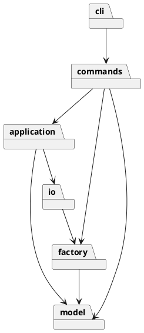

# Lab1 SVG CLI — 架构与过程记录

作业归属：朱凡（26213050517）。本仓库由 AI 智能体协助实现，提交者身份为 OpenAI Codex，不冒充学生手工提交。实际开发开始于 2026-11-01；不回填日期，原截止时间已过。

## 架构方案

- `model`：封装图形状态、几何与 Composite 树操作。
- `factory`：唯一图形类型名分派点。
- `commands`：Command 模式，每项命令一类；命令名分派集中在 CommandFactory。
- `application`：文档、事务快照、撤销重做与编辑会话。
- `io`：XML 与文件适配器。
- `cli`：分词、逐行 REPL。

依赖规则：model 不依赖上层；factory 仅依赖 model；io 依赖 factory/model；application 依赖 model/io；commands 依赖 application/factory/model；cli 依赖 commands/application。底层不依赖命令或 CLI，以免 UI 变化污染几何与树结构。

Command 将用户操作封装成对象；Composite 让容器与叶子统一接受 move/scale/set；编辑事务采用深复制快照（Memento），失败恢复状态，成功一条命令一条历史。仅 CommandFactory 与 ShapeFactory 按名字分派，这两处按题目要求标记为未来插件注册机制的**待重构点**。

变化点：未来插件类型集中在 factory；新增操作集中在 commands；文件存储隔离在 io；未来超大文件可能需增量历史，当前选择可靠但 O(n) 的快照，不提前实现复杂逆操作。box 明确不属于阶段一。

## 过程记录

1. AI 阅读教师原文后建立独立仓库、严格 TS 工程骨架，分离模型、XML 与命令实现。以下记录只描述实际 AI 工作，不虚构学生审查或讨论。
2. 识别易错点：导入先预留显式 id；根级容器禁止 ungroup；失败不得清空 redo；文档 IO 成功后锁定 undo/redo；SVG 前景对应兄弟数组末尾。

## 一致性自查

实际目录与方案一致；完整依赖矩阵和一类一文件扫描通过，详见下文自动化检查。

## 质量保证手段

已通过类型检查、23项自动化测试、CLI 脚本回放、SVG XML 读写往返与架构依赖检查，实际结果见末节。

### 实际迭代补充（2026-11-01 UTC）

3. 模型与工厂实现后，5 项模型测试通过。首次依赖安装遇到默认 npm 缓存目录不可创建；改为工作允许的 `/tmp/svg-npm-cache` 后安装成功。`tsx` 可执行启动器的 IPC socket 在沙箱中失败，改用官方 Node loader 形式 `node --import tsx`，不需要 IPC。
4. 实现 XML 与文件适配器后，独立测试验证缺 id 预留、重复 id、恶意/不支持 XML 拒绝、原子写入。进一步发现 XML 属性空白与 CR 可能在解析中规范化丢失，改用字符引用，加入真实回归测试。
5. 实现全部命令、快照事务与 REPL，并实际回放教师两节点流程图，成功输出 8 元素 SVG。独立架构检查验证所有内部依赖和一类一文件。
6. AI 自查发现混合父节点 group 的放置实现与注释有偏差，改为统一根级追加；支持 `init 400` 默认高度600；统一命令数字参数验证为十进制/科学计数法；集中格式化源代码。

### 已明确的边界与语义

- 支持六种内置类型；`box` 返回题目规定的 unknown shape type。插件复合类型尚未注册，所以不能生成须拒绝解组的插件对象；导入 `data-kind="box"` 按题目允许的无插件降级语义作为普通 g 保留标记。
- `set g fill/stroke/stroke-width` 设置容器属性，使用 SVG 自身样式继承，显式子样式不被覆盖；move/scale 递归修改子孙几何。
- 同父元素 group 占据第一个入选元素位置；跨父元素 group 放在画布根末尾；成员顺序按原文档遍历顺序保留，不按参数乱序。题目未规定跨父新组位置，故明确此决定。
- `front` 移到兄弟序列末尾（后绘制），`back` 移到开头；ungroup 仅普通非根级 g，子节点原地提升。
- 新编辑发生后 redo 清空；成功 init/read/save/canvas修改清空历史并锁定 undo/redo，直到下一次成功编辑。查询 canvas 不改变历史。失败命令不修改文档、保存路径或历史。
- 成功提示为语义摘要，撤销重做反馈 `undo completed` / `redo completed`，不逐字仿造示例中的操作特定提示。
- XML 读写支持本阶段元素、几何和常见展示属性，保留文本、嵌套、顺序、viewBox；不声称支持任意 SVG。transform、style、脚本事件、外部实体、未注册标签等明确拒绝，避免读后静默损坏。`set` 白名单严格按题目，不等同导入可保留的属性集合。
- 保存采用同目录临时文件加 rename；文件读写失败输出题目规定错误。导入生成 id 前预留全部显式 id（含 svg 根 id）；自动补全警告仅导入成功时返回。
- `canvas w h` 会将已有 viewBox 重置为 `0 0 w h`；未设置 viewBox 的文档保持不设置。

### 当前一致性核验

实际目录与原方案一致。`test/architecture.test.ts` 自动扫描全部源文件：每文件恰一导出类且文件名匹配；所有相对依赖遵循前述矩阵；无 switch 分派。model 不依赖应用层，commands 名称表与 shape 名称表各集中一处。主入口只启动 Main 类。

### 交付与诚实性

仓库为 https://github.com/Bamboovan/fudan-svg-editor-lab1 。本地 git 身份仅仓库级配置为 OpenAI Codex，未修改全局配置。开发采用真实分步提交，无重写旧日期；原截止时间 2026-10-31 23:59（北京时间）已过，不能声称按时完成。远程发布和 final 标签以实际完成时间为准。

发布说明：云执行环境没有 GitHub git 凭据，常规 `git ls-remote` 失败。远程通过已授权 GitHub connector 重放真实本地分步提交的快照与顺序，因此远程提交 SHA / 创建时间与本地不同；不是声称直接 git push 或伪造早期历史。全部时间均为实际时间，未 backdate。

### 最终本地验证结果（2026-11-01 UTC）

环境：Node.js v24.22.1，npm 11.9.0。

| 检查 | 实际结果 |
|---|---|
| `npm ci --cache /tmp/svg-npm-cache` | 成功，基于锁文件干净安装 |
| `npm run typecheck` | 通过，严格 TS |
| `npm test` | **23/23 通过**，无跳过、无失败 |
| `npm run build` | 通过，产物 dist/ |
| `npm run format:check` | 全部通过 |
| `npm run check` | 上述四项组合全部通过 |
| `npm audit --json --cache /tmp/svg-npm-cache` | 已知漏洞总数 0（该次查询结果，不保证未来） |
| 教师流程图实际子进程回放 | 成功，保存 8 元素，读回核验 undo 后几何与更新后文字 |

测试分布：独立验收9项、架构1项、CLI/分词2项、XML/文件6项、模型5项。覆盖所有命令族、六种图形、浮点几何、深层 Composite、错误精确前缀、ID冲突、循环拒绝、失败原子性、undo/redo边界、z-order、文本转义和 XML 空白保真。此为真实 AI 独立检查，不代表学生已经人工验收。

`.github/workflows/ci.yml` 配置 Node.js 22/24 的同一检查。此文档记录的是本地实际通过；远程 CI 是否完成需以 GitHub 对应提交的运行记录为准。
