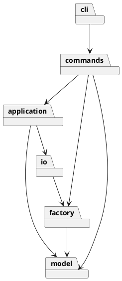

# Lab1 SVG CLI — 架构与过程记录

作者：朱凡（26213050517）

本项目采用 TypeScript 面向对象实现 SVG 命令行编辑器，按课程要求使用 AI 智能体辅助开发。本文记录架构选择、关键迭代与验证结果。

## 架构方案

- `model`：封装图形状态、几何与 Composite 树操作。
- `factory`：唯一图形类型名分派点。
- `commands`：Command 模式，每项命令一类；命令名分派集中在 CommandFactory。
- `application`：文档、事务快照、撤销重做与编辑会话。
- `io`：XML 与文件适配器。
- `cli`：分词、逐行 REPL。

依赖规则：model 不依赖上层；factory 仅依赖 model；io 依赖 factory/model；application 依赖 model/io；commands 依赖 application/factory/model；cli 依赖 commands/application。底层不依赖命令或 CLI，以免 UI 变化污染几何与树结构。

Command 将用户操作封装成对象；Composite 让容器与叶子统一接受 move/scale/set；编辑事务采用深复制快照（Memento），失败恢复状态，成功一条命令一条历史。仅 CommandFactory 与 ShapeFactory 按名字分派，这两处按题目要求标记为未来插件注册机制的**待重构点**。

变化点：未来插件类型集中在 factory；新增操作集中在 commands；文件存储隔离在 io；未来超大文件可能需增量历史，当前选择可靠但 O(n) 的快照，不提前实现复杂逆操作。box 明确不属于阶段一。

## 过程记录

### 1. 对齐要求，确定阶段边界

根据教师说明建立独立仓库和严格 TypeScript 工程骨架，将图形模型、XML 读写和命令处理分离。阶段一只实现 rect、circle、ellipse、line、text、g 六种类型，保留 `box` 为后续插件化目标，避免超出本阶段范围。

### 2. 从图形模型推进到命令与历史管理

先实现图形类层次和 Composite 容器，验证六种图形的几何操作、深复制及父子关系；首批 5 项模型测试通过后，再接入 Command、文档快照与 REPL。历史管理重点处理了两种边界：成功的文档类操作锁定 undo/redo，失败命令则保留文档、路径和已有 redo 状态。

### 3. 修正导入和序列化的边界问题

导入时先预留全部显式 id，再为缺 id 元素生成名称，避免自动名称与后出现的元素冲突。XML 往返测试进一步暴露了属性空白和文本 CR 可能因解析规范化而丢失的问题，序列化改用字符引用，并补充回归测试。对于不支持的 SVG 特性采用明确报错，而非静默删除。

### 4. 校正分组语义，补全验证

自查发现跨父节点分组的实际放置位置与注释不一致，修正为在画布根末尾追加；同父节点分组仍占据首个入选元素的位置。随后补充单参数 `init` 的默认高度，统一十进制及科学计数法参数验证，并完成代码格式化。

最后回放教师两节点流程图，成功保存并读回 8 元素 SVG；另以独立验收测试检查命令族、错误输出、历史边界和树结构操作。

### 实现边界与语义

- 支持六种内置类型；`box` 返回题目规定的 unknown shape type。插件复合类型尚未注册，所以不能生成须拒绝解组的插件对象；导入 `data-kind="box"` 按题目允许的无插件降级语义作为普通 g 保留标记。
- `set g fill/stroke/stroke-width` 设置容器属性，使用 SVG 自身样式继承，显式子样式不被覆盖；move/scale 递归修改子孙几何。
- 同父元素 group 占据第一个入选元素位置；跨父元素 group 放在画布根末尾；成员顺序按原文档遍历顺序保留，不按参数乱序。题目未规定跨父新组位置，故明确此决定。
- `front` 移到兄弟序列末尾（后绘制），`back` 移到开头；ungroup 仅普通非根级 g，子节点原地提升。
- 新编辑发生后 redo 清空；成功 init/read/save/canvas修改清空历史并锁定 undo/redo，直到下一次成功编辑。查询 canvas 不改变历史。失败命令不修改文档、保存路径或历史。
- 成功提示为语义摘要，撤销重做反馈 `undo completed` / `redo completed`，不逐字仿造示例中的操作特定提示。
- XML 读写支持本阶段元素、几何和常见展示属性，保留文本、嵌套、顺序、viewBox；不声称支持任意 SVG。transform、style、脚本事件、外部实体、未注册标签等明确拒绝，避免读后静默损坏。`set` 白名单严格按题目，不等同导入可保留的属性集合。
- 保存采用同目录临时文件加 rename；文件读写失败输出题目规定错误。导入生成 id 前预留全部显式 id（含 svg 根 id）；自动补全警告仅导入成功时返回。
- `canvas w h` 会将已有 viewBox 重置为 `0 0 w h`；未设置 viewBox 的文档保持不设置。

## 一致性自查

### 模块划分

实际目录与架构方案一致，没有未记录的模块调整。图形状态与行为封装在 model，命令、应用会话和 I/O 分别承担各自职责。

### 依赖方向

`test/architecture.test.ts` 自动扫描全部源文件，确认每个文件恰有一个导出类且类名与文件名一致，所有相对依赖均符合方案中的矩阵。model 不依赖应用层；命令名与图形类型名分派分别集中在 CommandFactory 和 ShapeFactory，未出现散落的 switch 分派。

## 质量保证手段

验证覆盖三个层次：模型测试验证几何、组合和克隆；集成测试验证命令、历史与 XML 往返；真实 CLI 子进程回放验证入口、脚本输入和文件输出。检查失败原子性时，同时关注文档内容、保存路径与撤销重做状态，而不只检查错误文字。

### 实际验证结果（2026-11-01 UTC）

本地环境：Node.js v24.22.1，npm 11.9.0。

| 检查 | 结果 |
|---|---|
| 锁文件干净安装（npm ci） | 成功 |
| `npm run typecheck` | 严格类型检查通过 |
| `npm test` | **23/23 通过**，无失败、无跳过 |
| `npm run build` | 通过 |
| `npm run format:check` | 通过 |
| `npm run check` | 上述四项组合通过 |
| npm audit | 当次查询已知漏洞总数为 0 |
| 教师流程图回放 | 成功保存 8 元素，读回验证撤销后的几何和更新后的文字 |

测试分布为验收 9 项、架构 1 项、CLI/分词 2 项、XML/文件 6 项、模型 5 项。覆盖六种图形、浮点几何、深层 Composite、ID 冲突、循环拒绝、失败原子性、undo/redo 边界、z-order、文本转义与 XML 空白保真。

远程提交 `e6fc7b4d16843939598c6ffe71b2169ec29c9da2` 的 GitHub Actions 验证已通过，Node.js 22、24 两个任务均成功（运行编号 `41285344155`）。本次文档修订不改变上述已验证代码。

## 附录：时间与版本记录

仓库：https://github.com/Bamboovan/fudan-svg-editor-lab1

实际开发与验证发生于 2026-11-01，晚于原截止时间 2026-10-31 23:59（北京时间）。提交及标签采用实际时间，未回填日期。

开发保留了真实分步提交。远程发布通过工具按本地开发顺序重放各次快照，因此本地与远程的提交 SHA、创建时间不同；快照对应关系和原始开发历史已另存为发布证据。
