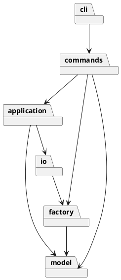

# Lab1 SVG CLI — 架构与过程记录

作业归属：朱凡（26213050517）。本仓库由 AI 智能体协助实现，提交者身份为 OpenAI Codex，不冒充学生手工提交。实际开发开始于 2026-11-01；不回填日期，原截止时间已过。

## 架构方案

- `model`：封装图形状态、几何与 Composite 树操作。
- `factory`：唯一图形类型名分派点。
- `commands`：Command 模式，每项命令一类；命令名分派集中在 CommandFactory。
- `application`：文档、事务快照、撤销重做与编辑会话。
- `io`：XML 与文件适配器。
- `cli`：分词、逐行 REPL。

依赖规则：model 不依赖上层；factory 仅依赖 model；io 依赖 factory/model；application 依赖 model/io；commands 依赖 application/factory/model；cli 依赖 commands/application。底层不依赖命令或 CLI，以免 UI 变化污染几何与树结构。

Command 将用户操作封装成对象；Composite 让容器与叶子统一接受 move/scale/set；编辑事务采用深复制快照（Memento），失败恢复状态，成功一条命令一条历史。仅 CommandFactory 与 ShapeFactory 按名字分派，这两处按题目要求标记为未来插件注册机制的**待重构点**。

变化点：未来插件类型集中在 factory；新增操作集中在 commands；文件存储隔离在 io；未来超大文件可能需增量历史，当前选择可靠但 O(n) 的快照，不提前实现复杂逆操作。box 明确不属于阶段一。

## 过程记录

1. AI 阅读教师原文后建立独立仓库、严格 TS 工程骨架，分离模型、XML 与命令实现。以下记录只描述实际 AI 工作，不虚构学生审查或讨论。
2. 识别易错点：导入先预留显式 id；根级容器禁止 ungroup；失败不得清空 redo；文档 IO 成功后锁定 undo/redo；SVG 前景对应兄弟数组末尾。

## 一致性自查

实现完成后补充实际检查结果。

## 质量保证手段

将通过类型检查、单元/集成测试、CLI 脚本回放、SVG XML 读写往返与架构依赖检查验证，完成后记录实际结果。
